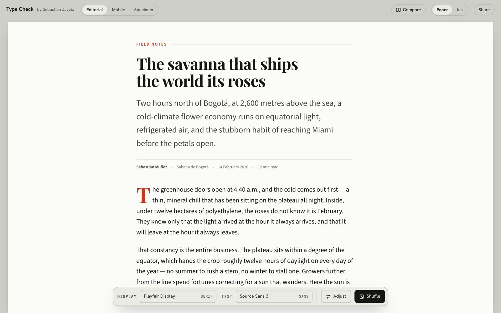
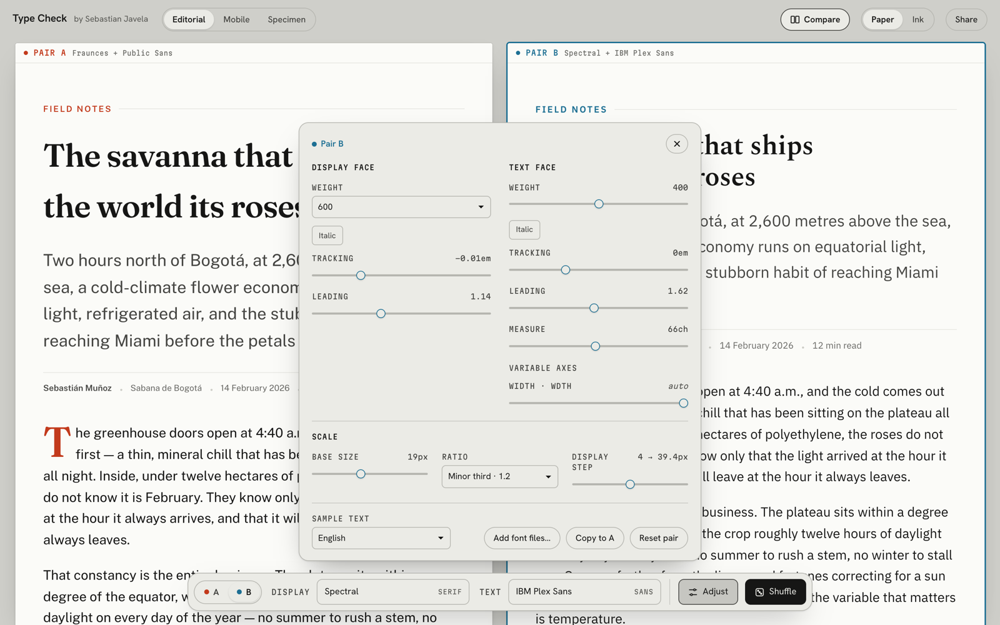

# Type Check

Pick two typefaces and check them on real text before you commit to them.

**Try it:** https://sebasjavela14.github.io/type-check/

## What it does

- **Three views of the same pair.** An editorial article, three phone screens, and a specimen sheet with the full type scale.
- **Compare two pairs side by side.** Click a sheet to edit it.
- **Adjust only when you need it.** Weight, tracking, leading, measure, variable axes and the type scale live in one panel.
- **1,600+ Google Fonts**, plus your own font files. Your files never leave your browser.
- **Share a link.** The link keeps the exact setup, so the other person sees what you see.
- **Copy the CSS** as custom properties, ready to paste.

## How it is built

One HTML file. No framework, no build step, no dependencies. Open `index.html` in a browser and it works.

Designed and built by [Sebastian Javela](https://sebasjavela.framer.website) with Claude as the maker. I did the art direction: three brand directions, three layouts, and the decisions between them.

## Privacy

Anonymous usage stats with Microsoft Clarity, no cookies. No accounts, nothing to sign up for. Your font files never leave your browser.

## License

MIT. Use it, fork it, change it. See [LICENSE](LICENSE).
